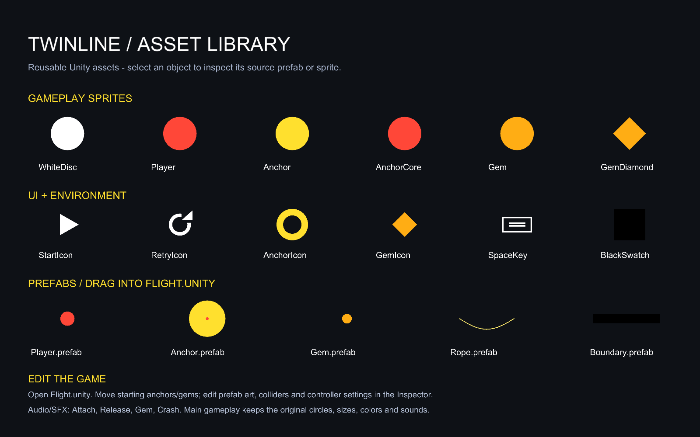

# Asset library and scene editing

The asset library is part of the existing Twinline project. Open it in Unity **6000.6.2f1**. The game retains the original simple shapes, colors, timing, and one-button controls.

For editing the actual starting scene, see [Start editing the scene](EditableProject.md). The HUD is now a native Canvas prefab in `Assets/Prefabs/UI`.

## Find the assets

Use the Project window to browse `Assets/Art/Sprites`, `Assets/Prefabs/Gameplay`, `Assets/Art/Materials`, and `Assets/Audio/SFX`. Open `Assets/Scenes/AssetLibrary.unity` for a visual gallery. Open `Assets/Scenes/Flight.unity` to return to the game.

The PNG sprites and WAV sound cues are real imported files, so they can be previewed, duplicated, replaced, and reused in another scene. The supplied art and cues derive from the original project's geometric visuals and synthesized sounds; no Asset Store download is required.

| Folder | Assets |
| --- | --- |
| `Assets/Art/Sprites/Gameplay` | White disc, player, anchor, anchor core, gem, and optional diamond gem |
| `Assets/Art/Sprites/UI` | Start, retry, anchor, gem, and Space-key icons |
| `Assets/Art/Sprites/Environment` | Black background swatch |
| `Assets/Art/Materials` | SpriteInk and RopeInk materials |
| `Assets/Audio/SFX` | Attach, Release, Gem, and Crash WAV files |
| `Assets/Prefabs/Gameplay` | Player, Anchor, Gem, Rope, and Boundary prefabs |

## Reuse and edit prefabs

The prefabs provide a player, an attachment anchor, a collectible gem, a rope renderer, and a boundary collider. Drag a prefab from `Assets/Prefabs/Gameplay` into a scene to create an instance. Double-click a prefab to edit its shared appearance or components in Prefab Mode. Apply an instance override only when the change should affect all instances of that prefab.

The player includes a `Rigidbody2D`, `CircleCollider2D`, and `SwingPlayer`. Anchors include their kinematic physics body and the visible target. Gems include a trigger collider and `SwingGemPickup`. The rope uses a `LineRenderer`, and boundaries use `BoxCollider2D` components.

A new object also needs to be registered with the game controller to take part in the run. On the object with `TwinSwingGame`, add anchors to **Scene Anchors** and gems to **Scene Gems**. The custom Inspector also provides **Register anchors and gems in this scene** to populate these arrays from the scene, and **Show sprite/prefab library** to locate the reusable assets. Assign the player, camera, rope, visual, audio source, and cue references when making a separate scene.

## Change the opening course

1. Open `Flight.unity` and leave Play mode.
2. Keep **Use Scene Objects** and **Use Authored Course** enabled on `TwinSwingGame`.
3. Move the anchor and gem instances with Unity's Move tool.
4. Save the scene and press Play.

The controller remembers the opening positions and restores them when the player retries. Objects that later recycle use **Anchor Spacing**, **Gem Spacing**, and the original seeded placement rules. Disabling **Use Authored Course** restores the generated opening layout.

## Replace sprites and sounds

Replace a `SpriteRenderer`'s **Sprite** reference to change its image. Match the existing sprite's import settings and pixels per unit when preserving its size. The original visual scale is deliberately small for the player and gems; anchor highlighting and the player's charge effect animate their visual transforms during play. Collider sizes are separate from sprite appearance and can be adjusted in the Inspector.

To use new art, place a PNG in the sprite folder, set its Texture Type to **Sprite (2D and UI)**, and use transparent padding only when it is intentional. Keep source artwork beside or clearly associated with exported sprites so later edits are repeatable.

Preview sound cues in `Assets/Audio/SFX`. Assign another imported `AudioClip` to the controller's attachment, release, gem, or crash cue. These references determine the sounds used by the saved scene.

## Scene tools

Opening the project preserves the saved scene. Use **Twinline → Build Editable Project** only when you want to recreate the supplied default assets and layout. Make a scene copy before rebuilding if you have customized the course.

The earlier `TwinlineRoot` and cooperative flight implementation remain available for historical prototype work. The authored swing scene uses `TwinSwingGame` directly, so its saved objects exist before Play starts.

## Verification

See the [saved-project checks](verification/saved-project-report.txt), [live Play checks](verification/playmode-report.txt), and [build notes](verification/build-report.txt).
